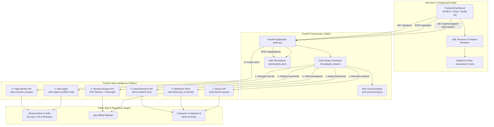

# LOANGUARD — HACKATHON PRESENTATION PACKAGE
## TinyFish-Powered Indian Loan App Risk Intelligence Platform
**Tagline:** Check before you borrow.  
**Core Message:** "Before you borrow, know what you're getting into."

---

## A. Three-Minute Pitch

### [0:00 - 0:45] The Problem
"In India today, predatory and fraudulent instant-loan apps have reached crisis levels. Vulnerable borrowers in financial emergencies download mobile apps promising 5-minute loans. What they actually get are extortionate hidden interest rates, unauthorized scraping of contacts and photo galleries, morphed-photo blackmail, and relentless harassment from abusive recovery agents.

The Reserve Bank of India maintains a public directory of authorized Digital Lending Apps (DLAs) deployed by regulated banks and NBFCs. But ordinary borrowers don't know how to navigate complex regulatory websites or verify corporate disclosures. In a financial panic, people borrow first and regret it later."

### [0:45 - 1:45] The Solution
"That is why we built **LoanGuard**. LoanGuard is an AI-powered risk intelligence platform that lets Indian borrowers investigate instant-loan applications *before* borrowing.

A user simply types the loan app name and optional website. Under the hood, LoanGuard orchestrates **all six capabilities of the TinyFish web intelligence stack**:
1. **Search:** Scours public search indices for complaint signals, harassment reports, and lending partner claims.
2. **Agent:** Autonomously navigates the official Reserve Bank of India (rbi.org.in) portal, handles tokenized redirects to the official Digital Lending Apps directory, and investigates whether the app is linked to a regulated entity.
3. **Fetch:** Scrapes public websites to extract critical regulatory disclosures—grievance redressal officers, registered business addresses, and APR disclosures.
4. **Browser:** Spins up a remote browser session via CDP to capture live visual evidence of the loan app's landing page.
5. **Research:** Executes deep research synthesizing public corporate filings and citations into an actionable report.
6. **Monitor:** Sets up an automated watch on the RBI directory to alert users if regulatory status changes."

### [1:45 - 2:30] The Risk Score & Safety First
"LoanGuard computes an objective, evidence-grounded risk score from 0 to 100 with clear bands: **LOWER RISK (70-100)**, **UNCLEAR (45-69)**, and **HIGH RISK (0-44)**.

Crucially, our scoring engine enforces strict safety rules:
- An unavailable RBI lookup applies an uncertainty deduction (-15), never a confirmed-absence penalty (-40).
- We never make unsupported legal claims or declare apps 'illegal'—we surface public risk indicators.
- Every single finding is backed by clickable public sources or timestamped visual screenshots.
- And for presentations, our deterministic Demo Mode runs on fictional sample data with zero hallucination risk."

### [2:30 - 3:00] The Vision
"LoanGuard puts regulatory defense directly into the hands of 1.4 billion citizens. With TinyFish handling autonomous navigation, live page inspection, and change monitoring, we turn fragmented public intelligence into instant consumer protection. **Before you borrow, know what you're getting into.** Thank you!"

---

## B. One-Slide TinyFish Feature Scorecard

| # | TinyFish Feature | Technical Integration | Specific Role in LoanGuard | Output / Artifact |
|---|---|---|---|---|
| 1 | **SEARCH** | `AsyncTinyFish.search.query()` | Queries 4 distinct threat vectors: complaints, harassment/recovery practices, named NBFC/bank partner, and RBI directory mentions. | Public search results with titles, snippets, and verified source URLs. |
| 2 | **AGENT** | `AsyncTinyFish.agent.run()` with `output_schema` | Navigates `rbi.org.in`, follows live session redirects to "DLA's deployed by Regulated Entities", inspects tables, and verifies regulated lending entity. | Normalized structured output: `{checked, found, matched_name, lending_entity, evidence, failure_reason}`. |
| 3 | **FETCH** | `AsyncTinyFish.fetch.get_contents(format="markdown")` | Ingests app landing pages and complaint forums; extracts regulatory transparency signals and counts complaint keywords (`harass`, `threat`, `blackmail`, `morph`, `extort`, `scam`, etc.). | Transparency checklist (grievance officer, lending partner, address, APR) + complaint keyword frequencies. |
| 4 | **BROWSER** | `POST https://api.browser.tinyfish.ai` + Playwright `connect_over_cdp()` | Spins up isolated cloud browser session, navigates to target website, takes high-fidelity viewport screenshot, saves locally, and deletes session. | Timestamped visual evidence PNG displayed in dashboard and saved in `static/evidence/`. |
| 5 | **RESEARCH** | `AsyncTinyFish.research.run(mode="deep")` | Synthesizes deep multi-source background investigation on app operator, legal structure, and verification steps. Non-blocking with timeout budget. | Cited analytical research report with referenced bibliography. |
| 6 | **MONITOR** | `AsyncTinyFish.monitors.create()` | Schedules automated recurring check on the RBI directory URL; triggers webhook alert when regulatory changes occur. | Persistent active monitor ID + stored alerts in `/api/alerts`. |

---

## C. Architecture Diagram

---

## D. Judge Questions & Answers

### 1. How accurate is LoanGuard?
> **Answer:** "LoanGuard does not make black-box guesses or probabilistic claims of legality. Instead, it measures **verifiable public signals**: whether an app appears in the official RBI digital lending directory, whether it names a regulated NBFC or bank partner, whether it discloses a grievance redressal officer and corporate address, and whether consumer forums show patterns of harassment keywords. Every deduction is explicitly itemized in the 'Why this score' breakdown with direct links to the underlying sources."

### 2. What if RBI directory access fails?
> **Answer:** "This is a core design feature of LoanGuard. The RBI directory is behind a session-tokenized redirect that can occasionally experience downtime or bot challenges. If our TinyFish Agent encounters a timeout or connection block, **it reports `checked=false` and retains the exact failure reason**. Our scoring engine explicitly differentiates between *confirmed absence* (-40 points) and *inability to verify* (-15 uncertainty points). We never report a failed lookup as a confirmed absence."

### 3. Does RBI endorse the app if it scores 100?
> **Answer:** "No, and LoanGuard makes this explicitly clear across the UI and in our legal disclaimer. The RBI directory is populated based on submissions by regulated entities and is not an independent quality rating or endorsement by the central bank. Our score reflects compliance transparency and absence of public red flags, but users must always verify loan terms directly with the regulated lender before signing."

### 4. How do you prevent false accusations against legitimate lenders?
> **Answer:** "We adhere to four strict principles:
> 1. We never use accusatory language like 'illegal app' or 'scam app'—we report objective indicators like 'No grievance officer found in inspected sources'.
> 2. In Demo Mode, we strictly use the fictional name `SampleLoan Demo` and non-clickable illustrative placeholders to ensure real brands are never associated with fictional complaints.
> 3. Negative findings are always framed as 'not found in inspected sources' rather than proof of absence.
> 4. Keyword counts are treated as signals requiring human review, not definitive proof of misconduct."

### 5. How does the application scale?
> **Answer:** "The frontend connects via asynchronous Server-Sent Events (SSE), meaning requests never block worker threads. Heavy operations like Deep Research and Browser session captures are executed asynchronously with strict timeouts. In high-volume production, investigations can be cached by app domain/name in Redis, and recurring searches can be triggered via background celery queues while borrowers receive cached instant assessments in milliseconds."

### 6. What is the business model?
> **Answer:** 
> - **B2C (Freemium):** Free instant risk scans for everyday borrowers to protect consumers.
> - **B2B API for Fintechs & Payment Gateways:** Payment aggregators (Razorpay, Cashfree) and app stores can query LoanGuard's API to vet digital lending merchants before onboarding.
> - **Cybercrime & Regulatory Intelligence:** Providing aggregated, anonymized threat telemetry and newly identified predatory app clusters to state cyber cells and consumer protection forums."

### 7. How do you protect user privacy?
> **Answer:** "LoanGuard **never** asks for or accepts borrower personal data, Aadhaar numbers, phone contacts, PAN cards, bank statements, or OTPs. The user only provides the name of the public application and optional website. All processing is strictly over public web data."

### 8. What would you build next?
> **Answer:** 
> 1. **Android APK Manifest Static Analysis:** Allowing borrowers to upload an APK to inspect dangerous runtime permissions (`READ_CONTACTS`, `ACCESS_MEDIA_IMAGES`) via automated sandbox before installation.
> 2. **Multi-language Voice & WhatsApp Bot:** Supporting vernacular voice queries in Hindi, Tamil, Telugu, and Marathi over WhatsApp so rural borrowers without computers can verify apps via voice note.
> 3. **Crowdsourced Grievance Escalation:** One-click forwarding of high-risk app dossiers directly to the RBI Sachet portal and National Cyber Crime Reporting Portal (cybercrime.gov.in)."

---

## E. Live Demo Script

1. **Pre-flight Check:**
   - Verify server is running on `http://127.0.0.1:8000`.
   - Open browser to `http://127.0.0.1:8000`.
   - Notice the header badge: `DEMO MODE (Sample Data)` or `LIVE MODE (TinyFish API)`.

2. **Step 1 — The Setup (15s):**
   - Point to headline: *"Before you borrow, know what you're getting into."*
   - Enter `SampleLoan Demo` into the input field.
   - Click **INVESTIGATE**.

3. **Step 2 — The Six TinyFish Stages (30s):**
   - Point to the live timeline updating in real-time via SSE:
     - **SEARCH:** Discovers public complaint reports and regulatory mentions.
     - **AGENT:** Navigates RBI digital lending apps directory.
     - **FETCH:** Scrapes website for grievance officer and APR disclosures.
     - **BROWSER:** Captures visual screenshot evidence.
     - **RESEARCH:** Prepares cited multi-source findings.
     - **MONITOR:** Confirms on-demand directory watch availability.

4. **Step 3 — Inspect Risk Assessment (45s):**
   - Show the dynamic gauge: **Score 0/100 — HIGH RISK**.
   - Show the exact deductions:
     - Application not found in RBI directory (-40 pts)
     - No named lending partner (-15 pts)
     - High complaint signal count (-25 pts)
     - No grievance details (-10 pts)
     - No interest disclosure (-10 pts)
   - Show the **RBI Directory Result** card: clearly marked `SIMULATED RBI RESULT — SAMPLE DATA` in demo mode (`NOT FOUND AFTER SUCCESSFUL CHECK` in live mode).
   - Show the **Visual Evidence** card: actual page screenshot loaded from disk.
   - Show the **Research Report** and verifiable citations.

5. **Step 4 — Trigger Monitoring & Download (30s):**
   - Click **"Monitor RBI directory"** button.
   - Watch it dynamically confirm active monitoring status without page reload.
   - Click **"Download report (JSON)"** to show machine-readable compliance report.
   - Click **"Check another app"** to demonstrate fluid reset.

---

## F. Backup Demo Instructions

If internet connectivity or live third-party network access is unstable during presentation:

1. **Ensure Demo Mode is Active:**
   - Check `.env`: `DEMO_MODE=1`.
   - Health check confirms: `http://127.0.0.1:8000/api/health` shows `"demo_mode": true`.

2. **Why Demo Mode is 100% Reliable:**
   - Reads pre-captured structured data from `demo/sample_events.json`.
   - Streams every single event through the real FastAPI SSE pipeline.
   - Renders the exact UI cards, SVG gauge, and timeline bars.
   - Guarantees zero latency, zero API rate limits, and zero timeout risk.

3. **Safety Compliance in Demo Mode:**
   - Clearly banners `SAMPLE DATA — DEMONSTRATION MODE`.
   - Displays label: *"Fictional demonstration assessment. No real lender has been assessed."*
   - Illustrative sources use non-clickable styled indicators to prevent broken links.

---

## G. One-Minute Explanation: Why TinyFish is Essential

"Why could LoanGuard not be built with standard LLMs or traditional web scrapers?

Traditional scraping breaks instantly on modern fintech ecosystems:
- **Dynamic JavaScript & Bot Protection:** The RBI portal uses tokenized redirect sessions and complex dynamic tables. Traditional scrapers get 'Unauthorized Access' immediately. TinyFish's **Agent** handles stateful navigation and interaction.
- **Visual Ground Truth:** Scrapers only see HTML; predatory apps often hide predatory terms inside canvas banners or images. TinyFish's **Browser API** provides real CDP rendering and visual proof.
- **Deep Signal Extraction:** Regex searching fails on nuanced legalese. TinyFish's **Fetch** strips noise and converts pages to semantic markdown, while **Research** performs multi-hop cross-referencing with verifiable citations.
- **Continuous Vigilance:** Lending apps get approved or deregistered daily. TinyFish's **Monitor** turns a static one-off check into persistent regulatory surveillance.

TinyFish isn't just an API in LoanGuard—it is the autonomous intelligence engine that makes consumer protection possible."
