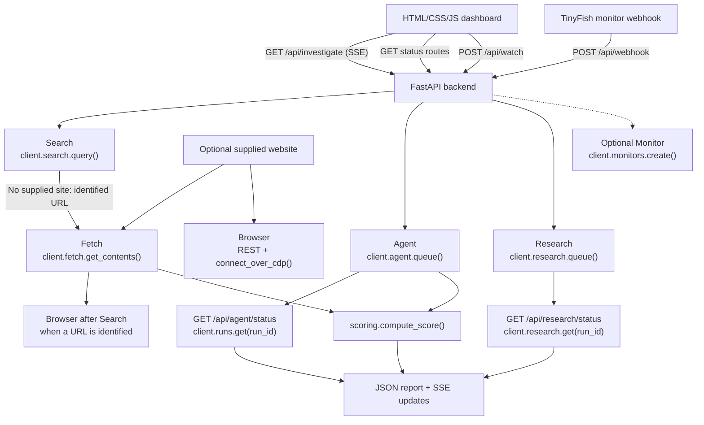

# LoanGuard - Check before you borrow

LoanGuard is a web-based risk-intelligence tool for Indian borrowers. It
inspects publicly available information about instant-loan applications and
shows preliminary risk indicators, evidence links, RBI directory verification,
and website-transparency checks.

- [Live demo](https://loanguard-five.vercel.app/)
- [GitHub repository](https://github.com/hemant2186/LoanGuard)

LoanGuard is **not an RBI service**, does not certify that a lender is
legitimate, and does not provide legal advice. A heuristic result does not
declare an app fraudulent. The report separates confirmed findings from
unavailable or incomplete checks, and does not require personal financial
information.

## Problem and solution

Borrowers may have difficulty checking an app's operator, regulated lending
partner, grievance process, pricing, address, and public complaint history
before borrowing. A user supplies a loan-application name and, optionally, its
website. LoanGuard combines public-source discovery, RBI directory navigation,
website inspection, visual evidence, and cited research into a report that
also explains what could not be verified.

## Features

- Preliminary score from 0 to 100 and a `LOWER RISK`, `UNCLEAR`, or `HIGH RISK`
  verdict.
- Verified and unverified findings with source links.
- RBI digital-lending-app directory result.
- Website transparency indicators and complaint-keyword signals.
- Browser screenshot evidence when a public URL is available.
- Asynchronous cited research when a report is returned.
- Optional, user-triggered monitoring of the RBI starting page.
- Demo mode with deterministic fictional sample data and no live TinyFish API
  calls.

## TinyFish integrations

LoanGuard uses `AsyncTinyFish` for the SDK-backed integrations. Each service
returns an explicit status or error; an unavailable service is not presented
as a successful check.

| Capability | SDK/API mechanism | Input | LoanGuard responsibility and output | Failure/timeout behavior |
|---|---|---|---|---|
| Search | `client.search.query(query)` | Three focused queries built from the app name and optional site | Discovers public evidence, source URLs, and a possible official website. Results expose title, URL, snippet, and description. | Each query records its error. The service is `failed` if no query returns results. |
| Agent | `client.agent.queue(goal=..., url=..., output_schema=...)`; later `client.runs.get(run_id)` | App name and `RBI_DLA_URL` starting page | Navigates the RBI site and clicks the visible DLA directory link, then returns structured `checked`, `found`, matched name, lending entity, evidence, and failure reason fields. | Queue timeout, missing run ID, failed runs, and inaccessible directories remain unverified; a failed check never becomes confirmed absence. |
| Fetch | `client.fetch.get_contents(urls, format="markdown", links=True, per_url_timeout_ms=60000)` | Up to 10 deduplicated site/search URLs | Extracts public page text and links, then detects grievance, lending-partner, address, interest-rate, contact, terms, privacy, and complaint-keyword indicators. | Missing URLs, SDK errors, and all-fetch failures produce an unavailable/failed result; missing indicators are not scored when no page was successfully inspected. |
| Browser | `POST https://api.browser.tinyfish.ai`, then Playwright `connect_over_cdp()` | A public URL and app name | Opens a remote browser session and saves a full-page=false screenshot under `static/evidence/`, returning a public evidence URL. | Non-201 responses, missing CDP data, navigation errors, persistence failures, and screenshot timeouts are reported as failed/unavailable. The remote session is deleted afterward. |
| Research | `client.research.queue(query=..., mode="deep")`; later `client.research.get(run_id)` | App name and optional site | Queues a cited analytical report covering operator, RBI partner, directory evidence, complaints, and transparency. Completed results include `deep_result.result` and citations. | Queue timeout or no run ID is reported without blocking the preliminary report. Queued/running/failed/cancelled/timed-out states are retrieved by the status route. |
| Monitor | `client.monitors.create("fetch", config, schedule_cron, purpose=..., webhook_url=...)` | RBI starting URL, daily `0 9 * * *` schedule, optional webhook URL | Creates a Page Monitor over the RBI starting page only after the user requests it. Webhook changes are stored in `demo/alerts.json`. | It is not created for every investigation. Beta, account, payment, credit, or provider errors are returned as an unavailable monitor message. |

Monitor is optional and user-triggered; it is not part of the automatic
investigation pipeline.

## Parallel execution architecture



In live mode, Search, Agent, and Research are started concurrently. If the
user supplies a website, Fetch and Browser start immediately as well. Without
one, Search can unlock Fetch and Browser when it identifies a suitable URL.
Agent and Research are queued independently and do not block the initial
report: their stored run IDs are polled by the frontend and their later
results reconcile the report and score. Monitor is a separate operation.

## API routes

| Method and route | Input | Purpose |
|---|---|---|
| `GET /` | None | Serves `index.html`. |
| `GET /api/investigate` | Query: required `name`; optional `site` | Streams the investigation as Server-Sent Events. An empty name returns HTTP 400. |
| `GET /api/agent/status` | Query: required `run_id` | Retrieves a queued Agent run through `client.runs.get(run_id)`. |
| `GET /api/research/status` | Query: required `run_id` | Retrieves a Research run through `client.research.get(run_id)`. |
| `POST /api/watch` | Optional JSON body: `webhook_url` | Creates or returns the on-demand RBI monitor; demo mode returns a simulated monitor. |
| `POST /api/webhook` | JSON body from the monitor provider | Stores a monitor notification in `demo/alerts.json`. |
| `GET /api/alerts` | None | Returns stored monitor alerts. |
| `GET /api/health` | None | Returns health, demo-mode, API-key-configured, RBI URL, and port status without exposing secrets. |

## Risk scoring

The pure, unit-tested `services/scoring.py` function starts at 100 and clamps
the result to 0-100:

| Condition | Deduction |
|---|---:|
| RBI directory was checked and the app was not found | 40 |
| RBI directory could not be checked | 15 |
| No grievance details in successfully inspected sources | 10 |
| No named NBFC/bank lending partner found | 15 |
| No registered address found | 5 |
| No interest-rate disclosure found | 10 |
| At least 8 complaint-keyword occurrences | 25 |
| 3-7 complaint-keyword occurrences | 12 |

Complaint deductions are mutually exclusive. Verdict bands are 70-100
`LOWER RISK`, 45-69 `UNCLEAR`, and 0-44 `HIGH RISK`; however, the lower-risk
verdict is only possible when the RBI check completed. Confidence is `high`
only when both RBI and Fetch checks completed, otherwise it is `limited`.

The distinction between **confirmed absence** and **inability to verify** is
important: only `checked=true, found=false` receives the 40-point directory
deduction. A failed lookup receives 15 points and remains unverified. Website
transparency deductions apply only after at least one public page was
successfully inspected. A missing field or keyword signal means it was not
found in inspected sources, not that it does not exist. Late Agent results can
therefore change the score and verdict in the browser.

Scores are heuristic preliminary assessments, not RBI ratings or endorsements.

## Technology stack

- Python 3.11+ with FastAPI and Uvicorn
- TinyFish Python SDK (`tinyfish>=0.11.0`)
- HTTPX and Playwright Chromium
- Plain HTML/CSS/JavaScript frontend with Server-Sent Events
- JSON file storage for demo fixtures and monitor alerts

## Installation and environment

The following commands are for Windows PowerShell:

```powershell
git clone https://github.com/hemant2186/LoanGuard.git
cd LoanGuard

python -m venv .venv
.venv\Scripts\Activate.ps1

pip install -r requirements.txt

python -m playwright install chromium

Copy-Item .env.example .env
```

Edit `.env` locally and provide your own TinyFish API key. Never put a real
key in source control:

```dotenv
TINYFISH_API_KEY=your_own_key
DEMO_MODE=1
RBI_DLA_URL=https://www.rbi.org.in/
PORT=8000
```

`DEMO_MODE=1` replays the fictional data in `demo/sample_events.json` and does
not call TinyFish. `DEMO_MODE=0` enables the live integrations and requires a
valid `TINYFISH_API_KEY`. The application loads `.env` locally through
`python-dotenv`; `.env` is ignored by Git.

## Run locally

```powershell
uvicorn main:app --host 0.0.0.0 --port 8000
```

Open <http://127.0.0.1:8000>. In demo mode, the report is deterministic sample
data and is labelled as such. In live mode, the backend reports provider
failures rather than silently replacing them with sample results.

## Testing

The repository's automated tests use fixtures and mocks for TinyFish service
calls, including the live-pipeline behavior; they do not require live API
credentials:

```powershell
pytest -q
python -m compileall -q main.py services tests
git diff --check
```

The diagnostic scripts are different: `python scripts/smoke_test.py` imports
and introspects the SDK, but makes one live Search call if a key is configured.
`python scripts/test_fetch.py [URL]` and
`python scripts/test_agent.py [APP_NAME]` require a key and make live calls.
Run those only when you intentionally want to consume TinyFish credits.

## Production deployment

- Frontend: <https://loanguard-five.vercel.app/>
- Backend: <https://loanguard-sqcb.onrender.com/>
- Repository: <https://github.com/hemant2186/LoanGuard>

Vercel serves the static frontend, whose production API base URL points to the
Render backend. Render runs the FastAPI application and keeps
`TINYFISH_API_KEY` exclusively in server-side environment variables. The
backend CORS configuration permits the production Vercel origin. Configure
production with `DEMO_MODE=0` for live investigations, and let Render's
injected `PORT` be used by the application; `main.py` reads that value when
started directly.

Do not put TinyFish credentials in frontend code or Vercel client-side
configuration.

## Output and limitations

The report can contain:

- Preliminary safety score, verdict, confidence, and deductions
- Verified findings and unverified findings
- Search evidence and source links
- RBI directory verification result
- Website transparency and complaint indicators
- Browser screenshot evidence
- Research report and citations
- Monitor status and later monitor alerts

Important limitations:

- RBI directory access or navigation can fail, and a failed lookup is not
  proof that an app is absent.
- Deep Research may take several minutes; it is queued and may remain pending,
  fail, or return no report.
- Browser evidence depends on URL accessibility, remote-session availability,
  screenshot persistence, and Playwright.
- Monitor is optional, beta/provider/account dependent, and is never created
  automatically.
- Complaint detection and transparency checks are keyword/signature heuristics.
- Results cover inspected public sources, not exhaustive verification.

Always independently verify the regulated lender, terms, pricing, and
grievance process before borrowing. LoanGuard is not an RBI service, legal
advice, lender approval, or guarantee of legitimacy.

## Contribution and security

- Never commit `.env`, API keys, or other credentials.
- Use `.env.example` for placeholders.
- Run the tests and compile check before submitting changes.
- Keep deterministic mock tests separate from intentionally live API scripts.
- Report security issues without including secrets or personal financial data.
