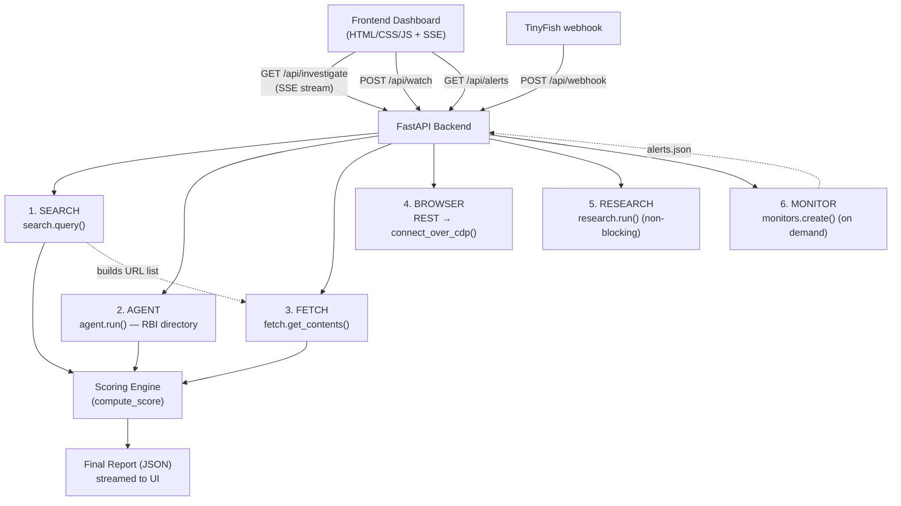

# LoanGuard — Check before you borrow.

LoanGuard helps Indian borrowers assess the **risk indicators** associated with instant-loan applications using public information and six TinyFish web-agent capabilities.

> LoanGuard provides preliminary risk indicators based on publicly available information. It is **not** an RBI service, legal opinion, or guarantee of lender legitimacy. RBI's directory is based on information submitted by regulated entities and is not independently validated by RBI. Always verify directly with the regulated lender before borrowing.

---

## Problem

Illegal and predatory instant-loan apps expose borrowers to hidden fees, unclear interest rates, harassment and threatening recovery practices, unauthorized access to contacts and personal information, misleading claims about lending partners, and unclear grievance-redressal mechanisms. People in financial emergencies often lack the time or ability to verify an application.

## Solution

A user enters a **loan app name** and an **optional website URL**. LoanGuard investigates publicly available information and returns:

- A **risk score out of 100** and a verdict (LOWER RISK / UNCLEAR / HIGH RISK)
- Plain-English **risk indicators** with evidence links
- **RBI directory** matching information
- **Website transparency** checks (grievance officer, lending partner, address, interest rate)
- **Public complaint** signals and source links
- **Browser screenshot** evidence
- A cited **research report**
- An option to **monitor** the RBI directory for changes

LoanGuard never claims to legally certify, approve, or declare an app illegal. It uses the terms "risk indicators", "public evidence", and "preliminary assessment".

---

## Architecture



The backend orchestrates the six TinyFish features, streams progress over **Server-Sent Events**, and assembles a final JSON report. Research is **non-blocking** (it runs with a short budget and does not stall the report). Monitor is only created **on demand** when the user clicks the Monitor button.

---

## The Six TinyFish Features

| # | Feature | TinyFish API / SDK method | What LoanGuard uses it for |
|---|---------|---------------------------|----------------------------|
| 1 | **Search** | `client.search.query()` | Discover public evidence (complaints, harassment, lending partner, RBI directory). |
| 2 | **Agent** | `client.agent.run()` (structured `output_schema`) | Navigate the RBI homepage, **click** the "DLA's deployed by Regulated Entities" link (preserving the tokenized redirect), search the directory, and return `{checked, found, matched_name, lending_entity, evidence, failure_reason}`. |
| 3 | **Fetch** | `client.fetch.get_contents()` | Read public pages (app site + complaint pages) as markdown and extract transparency indicators + count complaint keywords. |
| 4 | **Browser** | REST `POST https://api.browser.tinyfish.ai` → Playwright `connect_over_cdp()` | Capture a screenshot of the public page as visual evidence. |
| 5 | **Research** | `client.research.run()` | Generate a cited report (beta, non-blocking, fallback on timeout). |
| 6 | **Monitor** | `client.monitors.create()` | Schedule a Page Monitor over the RBI directory URL (on demand; beta — degrades gracefully to "unavailable"). |

Every integration is wrapped in `try/except` and returns a clear failure status. A failed RBI lookup is **never** reported as a confirmed absence (`checked=false` keeps `found=false`).

### Risk scoring engine

Pure, unit-tested function in `services/scoring.py`. Starting score 100:

| Indicator | Points |
|---|---:|
| Confirmed not found in RBI directory | 40 |
| RBI directory could not be checked | 15 |
| No grievance details found | 10 |
| No named lending partner found | 15 |
| No registered address found | 5 |
| No interest-rate disclosure found | 10 |
| Complaint keywords ≥ 8 | 25 |
| Complaint keywords ≥ 3 | 12 |

Complaint thresholds are **mutually exclusive** (25 OR 12). Final score is clamped to [0, 100]. Verdicts: 70–100 LOWER RISK, 45–69 UNCLEAR, 0–44 HIGH RISK. A missing field means "not found in inspected sources", never proof it does not exist.

---

## Setup

Requirements: Python 3.11+ (3.12 used in development).

```powershell
# 1. (optional) create/activate a virtual environment
python -m venv .venv
.\.venv\Scripts\Activate.ps1

# 2. install dependencies
pip install -r requirements.txt

# 3. Playwright browser (already provisioned on the dev machine)
python -m playwright install chromium

# 4. configure environment
Copy-Item .env.example .env
notepad .env
#   set TINYFISH_API_KEY=your-key   (get one at https://agent.tinyfish.ai/api-keys)
#   DEMO_MODE=1 for sample data, or 0 for live APIs

# 5. smoke-test the SDK (no live call without a key)
python scripts/smoke_test.py
```

## Run

```powershell
python main.py
# or: python -m uvicorn main:app --port 8000
```

Then open http://127.0.0.1:8000 (or the port in `.env`).

## Test

```powershell
# unit tests for the scoring engine
python -m pytest tests/test_scoring.py -v

# verify the demo-mode SSE pipeline (no server needed)
python scripts/verify_demo.py

# integration smoke tests (require TINYFISH_API_KEY)
python scripts/test_fetch.py https://example.com
python scripts/test_agent.py "KreditBee"
```

---

## Demo mode

`DEMO_MODE=1` replays saved sample data (`demo/sample_events.json`) through the full pipeline so the demonstration **never** depends on live API availability. Every demo result is visibly labelled **"SAMPLE DATA — DEMONSTRATION MODE"**. Live errors are never silently replaced with sample data, and live results are never silently replaced with demo data — the two are clearly distinguished.

## Limitations

- Research (deep mode) takes 5–20 minutes live, so in live mode it runs with a short budget and may report "still running" rather than block the report. Demo mode shows a complete sample report.
- The RBI digital lending apps directory is served behind a tokenized redirect; the Agent is instructed to **click** the live link rather than navigate to a copied URL. If the directory is unreachable, LoanGuard reports `checked=false` with the actual error — never a confirmed absence.
- Indicator detection is heuristic (keyword/signature matching over public page text). Findings mean "present in inspected sources", not exhaustive verification.
- Monitor is a beta capability and may be unavailable for some accounts; the UI shows a clear "beta feature not enabled" message in that case.

## Legal disclaimer

LoanGuard provides preliminary risk indicators based on publicly available information. It is not an RBI service, legal opinion, or guarantee of lender legitimacy. RBI's directory is based on information submitted by regulated entities and is not independently validated by RBI. Always verify directly with the regulated lender before borrowing.
